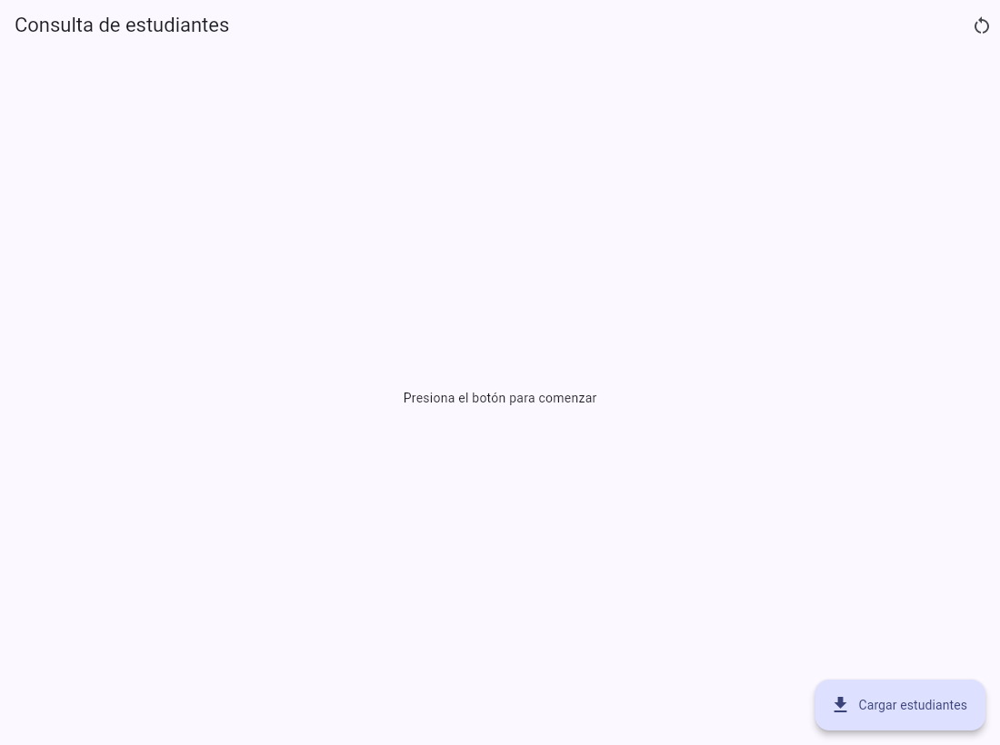
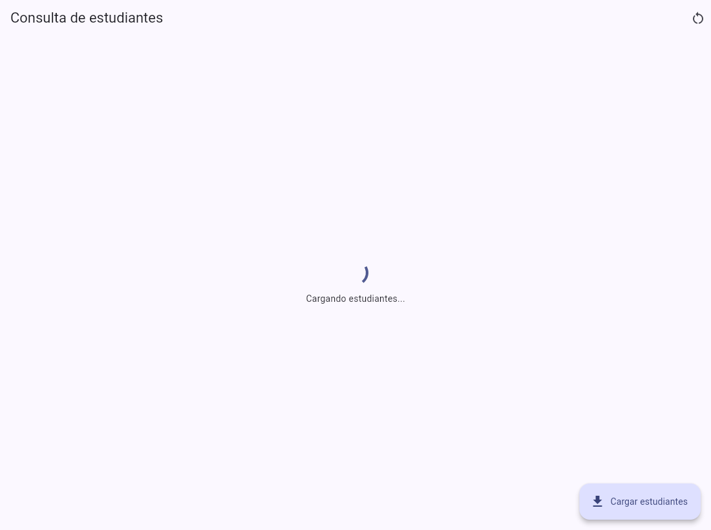
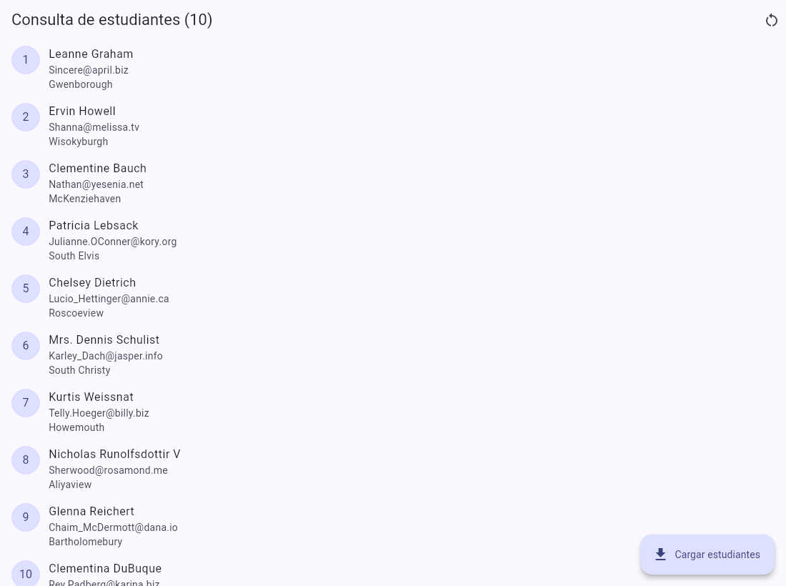
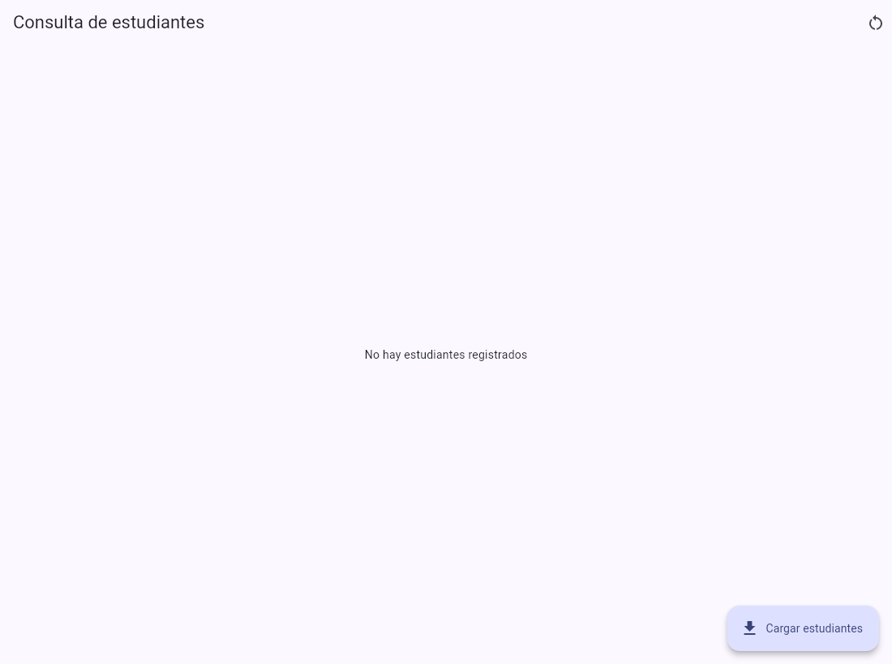
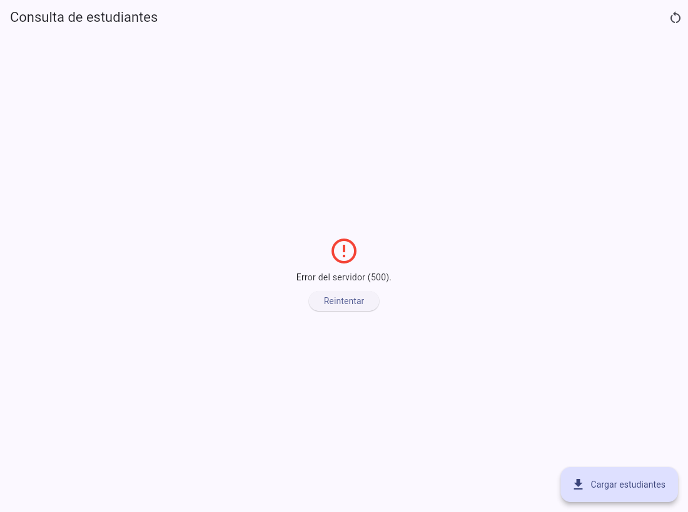
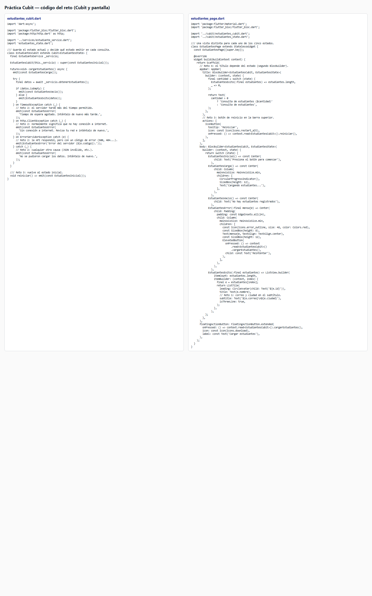

# Práctica: Consulta de estudiantes con Cubit en Flutter

**Desarrollo de Aplicaciones Móviles — Unidad 4: Estados en Flutter**

| Dato | Valor |
| --- | --- |
| Integrante 1 | *(completar)* |
| Integrante 2 | *(completar)* |
| Grupo | *(completar)* |
| Asesor | Josué Israel Vásquez Martínez |
| Fecha | 24 de noviembre de 2026 |

## Objetivo

Implementar la gestión de estados con Cubit (`flutter_bloc`) para consultar una API y representar los cinco estados de una consulta (inicial, carga, éxito, vacío y error), comprendiendo cómo el Cubit emite estados y cómo la interfaz se redibuja a partir de ellos.

---

## 1. Estructura del proyecto

```
lib/
├── main.dart
├── models/
│   └── estudiante.dart
├── services/
│   └── estudiante_service.dart
├── cubit/
│   ├── estudiantes_state.dart
│   └── estudiantes_cubit.dart
└── screens/
    └── estudiantes_page.dart
```

Dependencias añadidas: `flutter_bloc`, `http` y `equatable`. Se eliminó `test/widget_test.dart` porque hacía referencia al contador de ejemplo. Se añadió `<uses-permission android:name="android.permission.INTERNET"/>` en `AndroidManifest.xml` para que la API funcione también en release.

## 2. Descripción de los cambios del reto

| N.º | Actividad | Archivos modificados | Estado afectado | Qué se redibuja / resultado |
| --- | --- | --- | --- | --- |
| 1 | Campo `ciudad` | `models/estudiante.dart`, `screens/estudiantes_page.dart` | `EstudiantesExito` (datos, no el tipo de estado) | Cada `ListTile` muestra ahora correo y ciudad en el `subtitle`. El Cubit y los estados no cambian. |
| 2 | Mensajes de error distintos | `cubit/estudiantes_cubit.dart`, `services/estudiante_service.dart` | `EstudiantesError` | La vista de error muestra un texto distinto según `TimeoutException`, `http.ClientException`, `ErrorServidorException` (código HTTP) o causa general. |
| 3 | Botón de reinicio | `screens/estudiantes_page.dart` | Vuelve a `EstudiantesInicial` | `IconButton` en `AppBar.actions` llama a `reiniciar()`; el cuerpo vuelve al mensaje inicial y el título pierde el contador. |
| 4 | Contador en el título | `screens/estudiantes_page.dart` | `EstudiantesExito` | Segundo `BlocBuilder` en el `AppBar`: `Consulta de estudiantes (10)`. Solo se reconstruye el título, no toda la pantalla. |
| 5 | Probar los cinco estados | `main.dart`, `services/estudiante_service.dart` | Los cinco | Se usan variables de entorno (`SIMULAR_VACIO`, `SIMULAR_CARGA_LENTA`, `URL_API`) para provocar cada estado sin modificar la lógica del Cubit. |

### Cómo provocar cada estado

```bash
flutter run                                                   # Inicial → Carga → Éxito
flutter run --dart-define=SIMULAR_CARGA_LENTA=true             # Carga (3 s)
flutter run --dart-define=SIMULAR_VACIO=true                   # Vacío
flutter run --dart-define=URL_API=https://jsonplaceholder.typicode.com/no-existe  # Error 404
# Error sin internet: activar modo avión y pulsar "Cargar estudiantes"
```

Para las capturas se ejecutó la compilación web real (`flutter build web --release`) en Chrome y se interceptó la petición a la API con DevTools Protocol para devolver `[]` (Vacío) y `500` (Error). El Cubit no se modificó para obtener las evidencias.

---

## 3. Actividades conceptuales

### A. ¿Qué estado se emite?

| Situación | Estado que se emite | Qué ve el usuario |
| --- | --- | --- |
| Se abre la aplicación por primera vez | `EstudiantesInicial` | «Presiona el botón para comenzar» |
| El usuario presiona *Cargar estudiantes* | `EstudiantesCarga` | Círculo girando y «Cargando estudiantes...» |
| La API responde con los 10 usuarios | `EstudiantesExito` | Lista de 10 estudiantes con nombre, correo y ciudad; título «Consulta de estudiantes (10)» |
| La API responde correctamente con una lista vacía | `EstudiantesVacio` | «No hay estudiantes registrados» |
| El teléfono no tiene internet | `EstudiantesError` | Icono rojo, «Sin conexión a internet...» y botón *Reintentar* |
| La API responde con código 500 | `EstudiantesError` | Icono rojo, «Error del servidor (500).» y botón *Reintentar* |
| El usuario presiona el botón de reiniciar | `EstudiantesInicial` | Vuelve al mensaje inicial y desaparece el contador del título |

### B. ¿Qué capa es responsable?

| Elemento del código | Capa | Por qué |
| --- | --- | --- |
| `Estudiante.fromJson(...)` | Modelo | Convierte el JSON de la API (incluida `address.city`) en un objeto `Estudiante`. |
| `http.get(...).timeout(...)` | Servicio | Encapsula el acceso HTTP y el límite de tiempo de espera. |
| `emit(const EstudiantesCarga())` | Cubit | Publica el nuevo estado para que los `BlocBuilder` se reconstruyan. |
| `props` en `EstudiantesExito` | Cubit (estado) | Define la igualdad por valor de los estados para evitar reconstrucciones innecesarias. |
| `BlocBuilder<EstudiantesCubit, EstudiantesState>` | Pantalla | Escucha el Cubit y decide qué widget mostrar para cada estado. |
| `context.read<EstudiantesCubit>().cargarEstudiantes()` | Pantalla | Obtiene el Cubit desde el botón y llama al método sin suscribirse a cambios. |
| `BlocProvider(create: ...)` en `main.dart` | Pantalla | Crea el Cubit en la raíz de la interfaz y lo comparte con los widgets descendientes. |
| El parámetro `simularVacio` | Servicio | Simula una respuesta vacía para probar el estado `EstudiantesVacio`. |

---

## 4. Evidencias y capturas

### Figura 1. Estado Inicial



**Descripción:** al abrir la app, el Cubit está en `EstudiantesInicial`. El cuerpo muestra «Presiona el botón para comenzar» y el título no lleva contador. El botón *Cargar estudiantes* está disponible en la esquina inferior derecha.

### Figura 2. Estado Carga



**Descripción:** después de pulsar el botón (con `SIMULAR_CARGA_LENTA=true`), el Cubit emite `EstudiantesCarga`. Aparece el `CircularProgressIndicator` junto al texto «Cargando estudiantes...».

### Figura 3. Estado Éxito



**Descripción:** la API devolvió 10 usuarios. El título indica «Consulta de estudiantes (10)» y el `ListView.builder` muestra id, nombre, correo y **ciudad** de cada estudiante (reto 1).

### Figura 4. Estado Vacío



**Descripción:** con `SIMULAR_VACIO=true` (o una respuesta `[]`), la consulta termina correctamente pero la lista está vacía. El Cubit emite `EstudiantesVacio` y la pantalla muestra «No hay estudiantes registrados».

### Figura 5. Estado Error



**Descripción:** al responder la API con `500`, el Cubit emite `EstudiantesError('Error del servidor (500).')`. Se ve el icono rojo, el mensaje específico y el botón *Reintentar*, que vuelve a llamar a `cargarEstudiantes()`.

### Figura 6. Código del Cubit y de la pantalla



**Descripción:** fragmentos finales de `lib/cubit/estudiantes_cubit.dart` y `lib/screens/estudiantes_page.dart` con los cambios del reto: `catch` específicos, `reiniciar()`, `AppBar` con dos `BlocBuilder` y `subtitle` con la ciudad.

---

## 5. Preguntas de reflexión

**1. ¿Qué es un Cubit y en qué se diferencia de manejar el estado con `setState`?**
Un Cubit es una clase que guarda el estado actual y expone métodos que lo cambian mediante `emit()`. Vive fuera del widget, por lo que se puede probar, reutilizar y compartir entre pantallas. Con `setState`, en cambio, el estado vive dentro del widget y queda mezclado con la interfaz; además, `setState` reconstruye ese widget y sus descendientes directamente.

**2. ¿Qué hace `emit()` y qué ocurre en la pantalla cada vez que se llama?**
`emit()` publica un nuevo estado en el stream del Cubit. Todos los `BlocBuilder` que escuchan ese Cubit reciben el estado y ejecutan su `builder` para decidir qué widget devolver. Si el estado nuevo es igual al anterior por `Equatable`, la reconstrucción se omite.

**3. ¿Para qué sirve `BlocBuilder` y por qué la pantalla no se redibuja completa cada vez?**
`BlocBuilder` suscribe una parte del árbol de widgets al Cubit y reconstruye solo esa parte cuando cambia el estado. En esta app hay dos: uno para el cuerpo (los cinco estados) y otro para el título (contador). Al cargar datos se actualiza el título y la lista sin recrear, por ejemplo, el `Scaffold` completo.

**4. ¿Por qué cada estado es una clase distinta y qué ventaja da declarar `EstudiantesState` como `sealed`?**
Cada clase representa una situación concreta con sus propios datos: `EstudiantesExito` lleva la lista y `EstudiantesError` lleva el mensaje. Al ser `sealed`, el compilador verifica que el `switch` de la pantalla cubra todos los estados; si se agrega uno nuevo y se olvida dibujarlo, el código no compila.

**5. ¿Qué función cumple `Equatable` en los estados? Da un ejemplo de lo que pasaría sin él.**
`Equatable` compara los estados por valor usando `props` en lugar de por identidad de objeto. Sin él, emitir dos veces `EstudiantesExito` con la misma lista crearía dos objetos distintos y la pantalla se reconstruiría innecesariamente; con él, el segundo `emit` se ignora porque los estados son iguales.

**6. ¿Por qué el Cubit no llama directamente a `http` y usa un servicio aparte?**
Para separar responsabilidades: el servicio conoce la URL, el `jsonDecode`, el timeout y los casos de prueba (`simularVacio`); el Cubit solo decide qué estado emitir. Así se puede cambiar la API o sustituir el servicio por un fake en pruebas sin tocar la lógica de estados.

**7. ¿Qué hace `BlocProvider` y qué error aparecería si la pantalla no estuviera dentro de uno?**
`BlocProvider` crea la instancia del Cubit y la pone a disposición de todos los widgets descendientes. Si la pantalla llamara a `context.read<EstudiantesCubit>()` sin ese proveedor, se lanzaría `ProviderNotFoundException` («Could not find the correct Provider above this widget»).

**8. ¿Qué cambios realizaste en el reto y qué archivos, estados y widgets se vieron afectados?**
Se añadió `ciudad` al modelo y al `subtitle` (`EstudiantesExito`); se diferenciaron los errores con varios `catch` (`EstudiantesError`); se agregó un `IconButton` de reinicio (`EstudiantesInicial`); se envolvió el título en un segundo `BlocBuilder` para mostrar el contador; y se parametrizó el servicio para provocar los cinco estados. Los widgets afectados fueron `ListTile`, `IconButton`, `AppBar.title`, el cuerpo del `BlocBuilder` y el `FloatingActionButton.extended`.

---

## 6. Conclusión

**Integrante 1:** *(escribe aquí un párrafo personal: qué aprendiste sobre el papel del Cubit al separar la lógica de la interfaz, qué dificultad tuviste —por ejemplo, entender la intercepción de errores o los dos `BlocBuilder`— y cómo te ayudaron los estados para representar cada situación de la consulta).*

**Integrante 2:** *(escribe aquí tu propio párrafo con tu experiencia: qué te costó más, cómo resolviste el reto de la ciudad anidada en `address` o la simulación del estado vacío, y qué te llevas de la comparación entre `setState` y Cubit).*

---

## 7. Comprobación antes de entregar

```bash
flutter analyze     # No issues found!
flutter test        # 4 pruebas del Cubit: todas pasan
flutter run         # abre la app y permite provocar los cinco estados
flutter build web --release   # compilación de las evidencias correcta
```

Los cinco estados se verificaron en la ejecución real: el texto accesible de cada captura confirma «Presiona el botón para comenzar», «Cargando estudiantes...», «Consulta de estudiantes (10)» con las 10 ciudades, «No hay estudiantes registrados» y «Error del servidor (500).».
